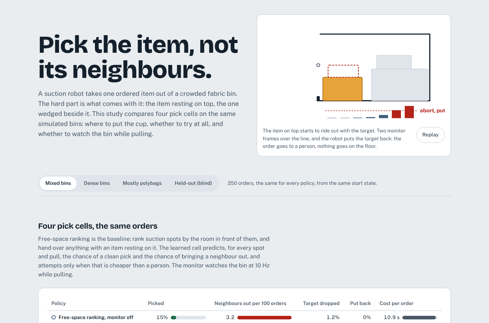

# pod-pick-lab

**Picking one ordered item out of a crowded fabric bin, without bringing its neighbours with it.**

A suction robot reaches into a storage-pod bin behind an elastic band, finds the item the order
asks for, puts its cup on it and pulls it out. The failure that costs most is not a missed pick:
it is the item resting on top, or wedged beside, coming out with the target and landing on the
floor. This repository builds and measures a pick cell around that problem:

- **perception**: a U-Net, told what the order is (catalogue size, colour, weight), finds the item
  in the depth and intensity image and says whether it is free, below other items or mostly hidden;
- **where to put the cup**: suction candidates on the item, described by the free space in their
  extraction corridor and what touches the item on each side;
- **whether to try at all**: a learned risk model predicts, for every candidate and every way of
  pulling, the chance of a clean pick, of a neighbour coming out, and of dropping the item; the cell
  attempts only when the expected cost is below a person's (in human-equivalent seconds);
- **watching while pulling**: an extraction monitor compares 10 Hz depth frames with the frame at
  the seal and puts the item back when a neighbour keeps pace with it. It is a dependency-free C++
  library, held equal to a Python reference on every frame;
- **a planner service** (FastAPI) with monitor sessions, a Docker image and Kubernetes manifests,
  tested end to end on a kind cluster in CI; a **dashboard** over the generated results.

Bins are simulated in MuJoCo with real contact (friction, stacking, a sewn lip, an elastic band, a
suction cup that peels under load) and a ray-cast camera ([ADR 1](docs/adr/0001-simulated-bins.md)),
so every pick's outcome is known exactly and every policy can be run on the same orders.



## What it measured

All numbers come from the committed run (`reports/results.json`; the full tables are in
[`docs/REPORT.md`](docs/REPORT.md)). Four pick cells pick the **same 250 orders** per family, from the
same start state, with the same sensor noise; differences are paired, with 95% bootstrap intervals.
"Cost" is human-equivalent seconds per order: robot time, a person picking what the robot did not,
75 s for every neighbour on the floor, 40 s for a dropped target (`config/policy.yaml`).

| Mixed bins (250 orders) | Picked | Success when attempted | Neighbours out / 100 orders | Cost / order |
|---|---:|---:|---:|---:|
| Free-space ranking, monitor off (the baseline) | 15.2% | 33.9% | 3.2 | 10.9 s |
| Free-space ranking, monitor on | 12.8% | 28.6% | 3.2 | 11.5 s |
| Learned risk, monitor off | 14.0% | 72.9% | 1.2 | 8.9 s |
| **Learned risk, monitor on** | **13.2%** | **68.8%** | **0.8** | **8.8 s** |

- **The learned risk model is what pays.** Against the baseline it brings out 2.4 fewer neighbours
  per 100 orders (95% interval −5.2 to −0.4) and saves 2.1 s per order (−4.5 to −0.2), with no
  detectable change in the share of orders picked (−2.0 points, −6.0 to +1.6). It does it by trying less (19% of orders against 45%) and succeeding more
  (69–73% against 34%). In dense bins the saving is larger: 4.0 fewer neighbours per 100 and 3.7 s
  per order.
- **The monitor helps little, and on the ranking it hurts.** On the learned cell it removes 0.4
  more neighbours per 100 (−1.2 to 0.0). On the ranking it aborts 12% of orders, mostly on falling
  vacuum (25 of 31 aborts), and puts back picks that would have succeeded: 2.4 points fewer picked,
  no fewer neighbours out. The vacuum rule is too eager; the neighbour rule is not the problem.
- **Mostly polybags: no gain.** Seals are poor and the learned cell is no better than the ranking there.
- **The blind held-out family** (book-heavy bins written from a one-page brief, run once): the learned
  cells cost less (−2.0 s per order, −4.5 to −0.1) and bring out fewer neighbours (0.8–1.2 against
  2.8 per 100, an interval that touches zero), and become very cautious: they attempt 10% of orders, at 75–88% success.
- **Its promises are mostly honest.** For its first choices the model predicted 71% success and
  72.9% happened; it predicted 2.7% collateral and 6.2% happened: it underestimates collateral.
- **Pretraining without labels did not help** at these sizes: masked reconstruction on 28,000 crops
  gave the same AUC as training from scratch at 600, 2,400 and 6,948 labelled attempts (success AUC
  0.91, collateral AUC 0.78–0.80 at the full budget). The finding Amazon reported for multi-suction
  picking does not carry over to this simulator and this model size.
- **The C++ monitor equals its Python reference** on all 821 frames of real extractions (120 orders)
  (signal and action), at a median of 146 µs per 64 × 48 frame through the Python binding (335 µs
  p99) against 373 µs for the reference. At 10 Hz that is about 0.15% of the tick.

### What is weak

- **The robot picks only one order in seven.** Every policy hands most orders to a person. Two
  reasons: half the targets have something resting on them or are mostly hidden, and the cost model
  values a robot pick at only the 9 s a person needs, against 75 s for a neighbour on the floor, so
  the learned cell attempts only when it is confident. The pick-rate targets in the release gate
  (60% on mixed bins, 40% on polybags) are missed and reported as missed.
- **Perception.** Mask IoU 0.69 on validation bins; about a third of wrong-item touches in development
  came from masks bleeding into neighbours ([ADR 7](docs/adr/0007-first-test-run.md)).
- **Abort thresholds rest on few examples**: 68 and 86 sealed validation attempts, with 4 and 3
  collateral events ([ADR 4](docs/adr/0004-monitor-thresholds.md)).

## How it is built

```
sim/          bins (MuJoCo): items dropped and settled, band, lip, suction as a compliant weld that
              peels over capacity; ray-cast depth + intensity with noise and a see-through band;
              snapshots for counterfactuals; datasets (perception labels, logged attempts, crops)
perception/   TargetNet: U-Net on depth + intensity, FiLM-conditioned on the order; mask + occlusion class
grasp/        candidates (normals, planarity, edge distance, corridor clearance, side contacts, 32x32
              crops); RiskNet: crop encoder (masked-reconstruction pretraining) + candidate-conditioned
              cross-attention, three heads
decide/       free-space ranking with eligibility; expected-cost decision over candidates x primitives
control/      the extraction monitor (reference) and the ctypes binding to cpp/
cell.py       observe, perceive, choose, open the band, approach to contact, seal, extract, abort
service/      POST /v1/plan, monitor sessions (/v1/monitor), /metrics, /readyz
evaluate/     paired experiments, tuning, held-out run, C++ parity bench, report, release gate
cpp/          monitor.cpp (C++17, no allocation per frame), unit tests, CMake
web/          React 19 + Motion dashboard; reads reports/*.json, computes nothing
deploy/       Dockerfile (C++ built and tested in a build stage), kustomize (restricted pods, no egress)
```

Decisions are in [`docs/adr/`](docs/adr). The full report, generated, is
[`docs/REPORT.md`](docs/REPORT.md).

## Run it

```bash
pip install torch --index-url https://download.pytorch.org/whl/cpu
pip install -e ".[train,service,dev]"
pytest -m "not slow"              # seconds
podpick all --profile quick       # the whole pipeline on a few bins, a few minutes
podpick all                       # the committed run: about two hours on two cores
podpick heldout                   # the blind family (its first run is already recorded)
podpick serve                     # the planner on :8080 with the committed models
python scripts/smoke.py http://localhost:8080
cd web && npm ci && npm run dev   # the dashboard
```

| Endpoint | |
|---|---|
| `POST /v1/plan` | Depth and intensity (base64 float32), the order, the band height. Returns pick or hand over, the candidates in order, their outcome probabilities and expected cost. |
| `POST /v1/monitor` | Opens a monitor session with the frame and mask at the seal. |
| `POST /v1/monitor/{id}/frame` | One 10 Hz frame, tool position and vacuum: `continue`, `slow` or `abort`. |
| `GET /healthz` `/readyz` `/metrics` | Liveness, models and C++ monitor loaded, Prometheus counters. |

CI ([`.github/workflows/ci.yml`](.github/workflows/ci.yml)): ruff and the tests (including C++
parity and truth isolation) and the release gate on the committed run; the C++ monitor with CMake,
`-Werror`, ctest and AddressSanitizer/UBSan; the quick pipeline end to end; the planner image
deployed to kind and checked against plans made locally; the dashboard with Biome, Vitest, a build,
and Playwright with axe on desktop and phone.

## Limits

- **Simulated, not real.** Items are boxes; polybags are soft boxes; the arm link does not touch
  items. The rates are rates in this simulator. What carries over is the method: paired
  counterfactual evaluation, risk labels from random attempts, thresholds chosen on validation
  logs, and a real-time monitor proven equal to its reference.
- **Perception is the weakest part** (mask IoU 0.69), and with it the pick rate (see above).
- **The test families were seen once before the final run** (aggregate only); see
  [ADR 7](docs/adr/0007-first-test-run.md). The held-out family was not.
- **CPU only.** Models are small; nothing here was trained on a GPU.
